<!-- To follow the viewer's GitHub theme instead, swap the img above for:
<picture>
  <source media="(prefers-color-scheme: dark)" srcset="dark_mode.svg">
  <source media="(prefers-color-scheme: light)" srcset="light_mode.svg">
  
</picture>
-->

[JetGoal beta key](mailto:honz.bartos@gmail.com?subject=JetGoal%20beta%20key) · [QuickHatch](https://github.com/JanBartos6/QuickHatch) · [AI Agent Security Workbench](https://github.com/JanBartos6/ai-agent-security-workbench) · [Smart Search Chips](https://github.com/JanBartos6/smart-search-chips) · [LLM from scratch](https://github.com/JanBartos6/llm-from-scratch) · [LinkedIn](https://www.linkedin.com/in/jan-bartos-5747022a3/)
